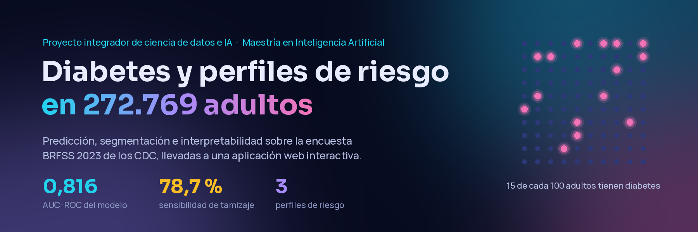
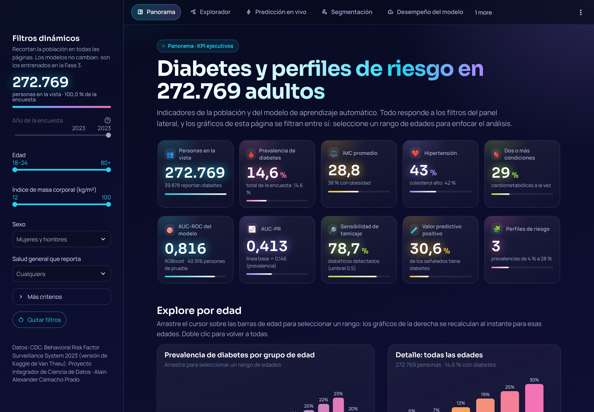
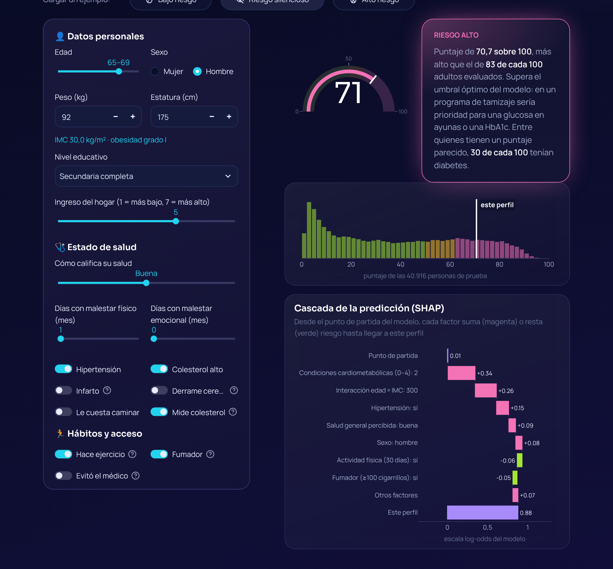
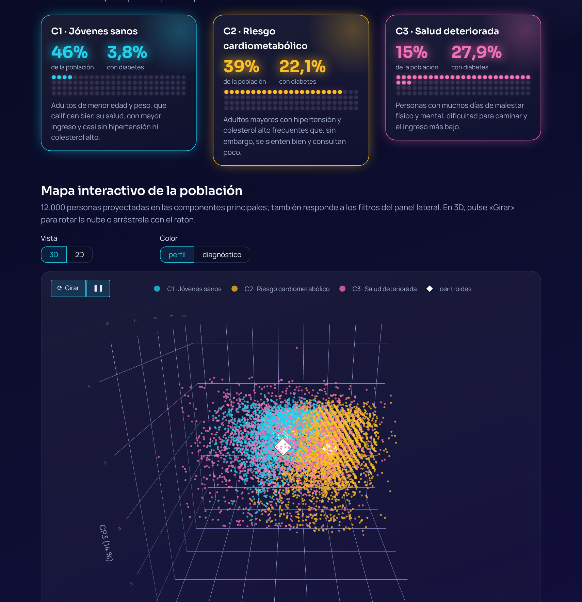
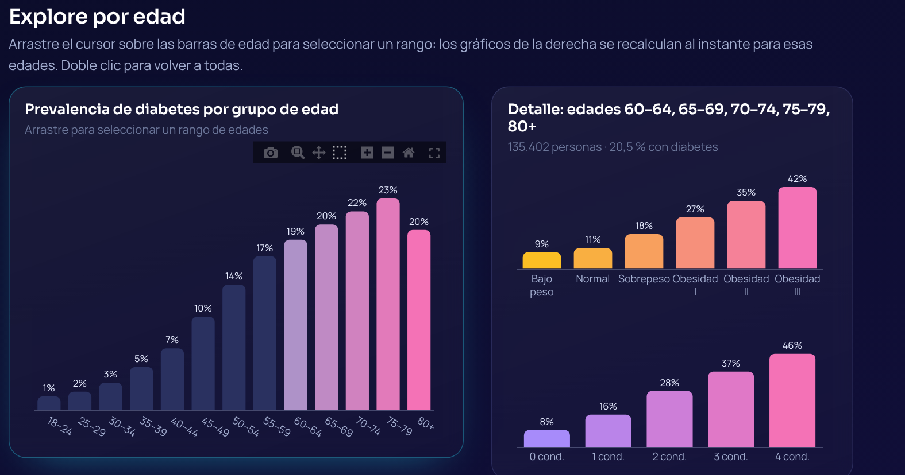
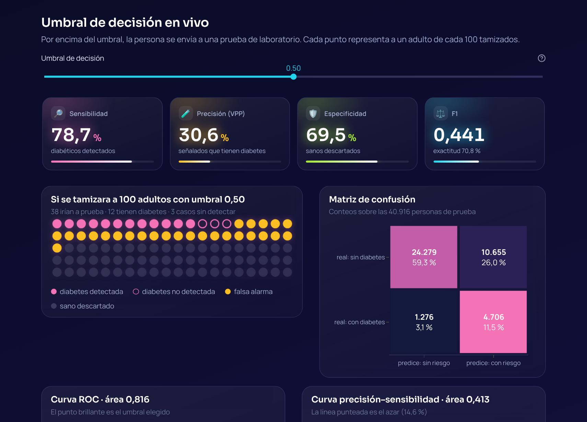
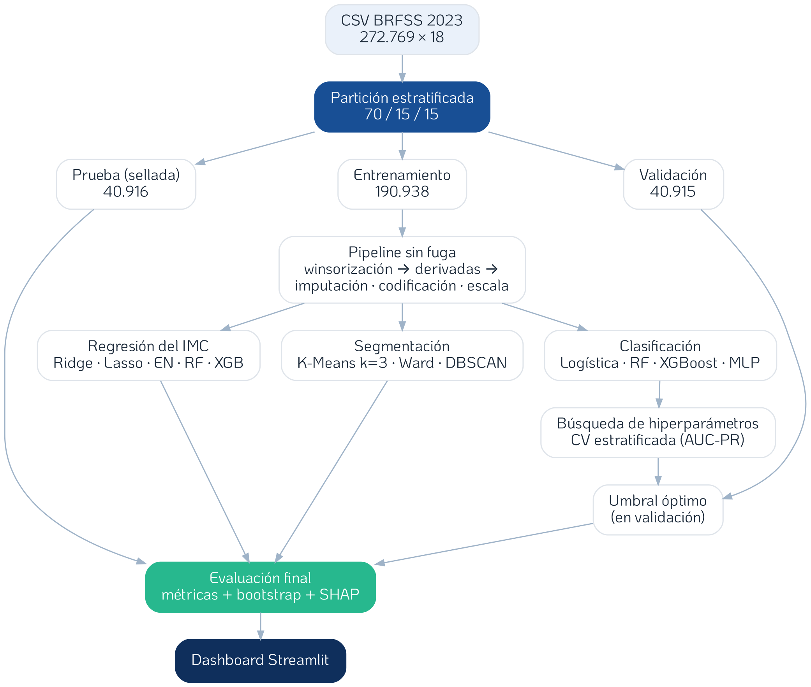

<p align="center">
  
</p>

<p align="center">
  <a href="https://alainkapra-diabetes-brfss2023.streamlit.app"></a>
</p>

<p align="center">
  <b><a href="https://alainkapra-diabetes-brfss2023.streamlit.app">Aplicación en vivo</a></b>
  &nbsp;·&nbsp;
  <b><a href="reports/FASE_4_ENTREGA_FINAL_ALAIN_CAMACHO.pdf">Artículo final (PDF)</a></b>
</p>

---

**Proyecto Integrador de Ciencia de Datos e Inteligencia Artificial** · Maestría en Inteligencia Artificial, Universidad de La Salle (Bogotá), 2026
**Autor:** Alain Alexander Camacho Prado, Md. · [acamacho88@unisalle.edu.co](mailto:acamacho88@unisalle.edu.co)
**Asignatura:** Ciencia de Datos · **Docente:** Fabián Camilo Castro Riveros

## De qué se trata

Las guías clínicas recomiendan tamizar la diabetes con glucosa o hemoglobina glicosilada, pero con recursos limitados la pregunta práctica es **a quién tamizar primero**. Este proyecto responde esa pregunta con aprendizaje automático sobre **272.769 adultos** de la encuesta *Behavioral Risk Factor Surveillance System* (BRFSS) 2023 de los CDC, usando solo información que una persona puede reportar en una encuesta.

Se presenta una solución completa de ciencia de datos para el riesgo de diabetes construida sobre 272.769 registros  y 17 predictores autorreportados de la encuesta Behavioral Risk Factor Surveillance System (BRFSS) 2023. El flujo incluye el tratamiento justificado de datos faltantes (simulación MCAR/MAR/MNAR) y atípicos, cuatro variables derivadas, un
preprocesamiento encapsulado en pipelines que elimina la fuga de datos, una partición estratificada 70/15/15 y el manejo del desbalance (1:5,84) con pesos de clase. Se compararon regresión logística, Random Forest, XGBoost y un perceptrón multicapa en PyTorch; regresiones Ridge, Lasso y ElasticNet y ensambles para el índice de masa corporal (IMC), y K-Means, DBSCAN y el método jerárquico de Ward para la segmentación. Los hiperparámetros se optimizaron con búsqueda aleatoria y validación cruzada estratificada; la incertidumbre se estimó por bootstrap y las predicciones se explicaron con TreeSHAP. En el conjunto de prueba, XGBoost alcanzó un AUC-ROC de 0,816 (IC 95 %: 0,810–0,821) y un AUC-PR de 0,413, con una sensibilidad de 78,7 %al umbral de 0,5; cuatro familias de modelos convergieron en el mismo desempeño, lo que indica un techo impuesto por la información y no por el algoritmo. El R2 del IMC fue de 0,186 y K-Means identificó tres perfiles con prevalencias de diabetes de 3,7 %, 22,1 % y 27,7 %. La solución se desplegó como una aplicación web interactiva en Streamlit, con filtros dinámicos, indicadores clave, predicción en vivo con explicación SHAP y segmentación en el espacio PCA (https://alainkapra-diabetesbrfss2023.streamlit.app), sobre un repositorio público reproducible (https://github.com/alainkapra/proyecto-diabetes-brfss2023).

El trabajo combina cinco frentes:

- **Clasificación:** estima el riesgo de diabetes con regresión logística, Random Forest, XGBoost y una red neuronal en PyTorch.
- **Regresión:** estima el índice de masa corporal con Ridge, Lasso, ElasticNet y ensambles.
- **Segmentación:** identifica perfiles de riesgo con K-Means, DBSCAN y el método jerárquico de Ward.
- **Interpretabilidad:** explica cada predicción con valores SHAP.
- **Aplicación web:** lleva todo lo anterior a una herramienta pública e interactiva.

## Resultados principales

Medidos en un conjunto de prueba de 40.916 personas que el modelo nunca vio durante el entrenamiento.

| Indicador | Valor | Qué significa |
|---|---|---|
| AUC-ROC (XGBoost) | **0,816** (IC 95 %: 0,810–0,821) | El modelo ordena bien a quién tiene más riesgo |
| AUC-PR | **0,413** | 2,8 veces mejor que el azar (línea base 0,146) |
| Sensibilidad (umbral 0,5) | **78,7 %** | Detecta casi 8 de cada 10 personas con diabetes |
| Valor predictivo positivo | **30,6 %** | 1 de cada 3 señalados tiene diabetes: sirve para priorizar, no para diagnosticar |
| R² del IMC (XGBoost) | **0,186** | Las respuestas de la encuesta explican una parte modesta del peso |
| Perfiles de riesgo (K-Means, k = 3) | **3,7 %, 22,1 % y 27,7 %** | Tres grupos con prevalencias de diabetes muy distintas |

> **Hallazgo central:** cuatro familias de modelos muy diferentes llegaron al mismo desempeño. El límite está en la información disponible y no en el algoritmo. Para mejorar, hacen falta mejores datos (laboratorio, antecedentes familiares) más que modelos más complejos.

## La aplicación

<p align="center">
  <a href="https://alainkapra-diabetes-brfss2023.streamlit.app"></a>
</p>

<table>
  <tr>
    <td width="50%"></td>
    <td width="50%"></td>
  </tr>
  <tr>
    <td><b>Predicción en vivo.</b> Riesgo individual, ubicación en la población y cascada SHAP que explica cada factor.</td>
    <td><b>Segmentación.</b> Los tres perfiles en un mapa 3D (PCA) que se puede girar, con sus perfiles promedio.</td>
  </tr>
  <tr>
    <td width="50%"></td>
    <td width="50%"></td>
  </tr>
  <tr>
    <td><b>Filtrado cruzado.</b> Al seleccionar un rango de edades, el resto de gráficos se recalcula para ese grupo.</td>
    <td><b>Desempeño del modelo.</b> Curvas, matriz de confusión y un umbral de decisión que se puede mover.</td>
  </tr>
</table>

| Módulo | Dónde está | Qué permite hacer |
|---|---|---|
| **Filtros dinámicos** | Panel lateral, en todas las páginas | Año de la encuesta, rangos de edad e IMC, sexo, salud, ingreso, educación, condiciones, perfil y diagnóstico |
| **Indicadores clave (KPI)** | Panorama y Desempeño del modelo | Contadores animados de la población y del rendimiento del modelo |
| **Predicción en vivo** | Predicción en vivo | Formulario del perfil, medidor de riesgo, cascada SHAP y escenarios «¿qué pasaría si…?» |
| **Segmentación** | Segmentación | Dispersión 3D y 2D en el espacio PCA, radar y perfiles promedio, validación del número de grupos |

Además, la aplicación incluye:

- la prevalencia animada por edad;
- un sunburst que se explora con clics;
- las rutas hacia la diabetes en categorías paralelas;
- un retrato de 100 personas tamizadas;
- la reproducción, época por época, del entrenamiento de la red neuronal.

## Cómo se construyó

<p align="center">
  
</p>

1. **Exploración (Fase 1).** Calidad de los datos, distribución de las variables y primeras asociaciones con la diabetes.
2. **Preparación (Fase 2).**
   - Simulación de datos faltantes (MCAR, MAR y MNAR) y tratamiento de atípicos.
   - Cuatro variables derivadas con sentido clínico.
   - Partición estratificada 70/15/15 y manejo del desbalance con pesos de clase.
3. **Modelado (Fase 3).**
   - Comparación controlada de clasificadores y regresores, con búsqueda de hiperparámetros y validación cruzada.
   - Intervalos *bootstrap*, segmentación con tres algoritmos y explicaciones SHAP.
4. **Despliegue (Fase 4).** Código modular, reentrenamiento reproducible, pruebas automatizadas y aplicación web pública.

Todo el preprocesamiento vive dentro de *pipelines* de scikit-learn. Así, ninguna transformación aprende de los datos de evaluación (sin fuga de datos), y la aplicación usa exactamente el mismo código que el entrenamiento.

## Documentos

| Documento | Contenido |
|---|---|
| [Artículo final (Fase 4)](reports/FASE_4_ENTREGA_FINAL_ALAIN_CAMACHO.pdf) | Informe técnico en formato de artículo científico |
| [Fase 1](reports/FASE_1_Diabetes_Health_Indicators_ALAIN_CAMACHO.pdf) | Análisis exploratorio |
| [Fase 2A](reports/FASE_2_ACT_3_Limpieza_Ingenieria_Variables_ALAIN_CAMACHO.pdf) | Limpieza e ingeniería de variables |
| [Fase 2B](reports/FASE_2_ACT_4_Particion_Modelo_Base_ALAIN_CAMACHO.pdf) | Partición y modelo base |
| [Fase 3](reports/FASE_3_Diabetes_Health_Indicators_ALAIN_CAMACHO.pdf) | Modelado avanzado, segmentación, optimización e interpretabilidad |

## Estructura del repositorio

<details>
<summary>Ver el árbol de carpetas</summary>

```
proyecto-diabetes-brfss2023/
├── data/
│   ├── raw/                     CSV original (cdc_brfss_diabetes_2023.csv)
│   └── processed/               datos con clúster y partición, muestra PCA y predicciones (parquet)
├── notebooks/
│   ├── 01_Fase2_Preprocesamiento_Baseline.ipynb
│   └── 02_Fase3_Modelado_Clustering_Optimizacion.ipynb
├── src/
│   ├── preprocesamiento.py      transformadores, variables derivadas y pipelines sin fuga de datos
│   └── entrenar_modelos.py      reentrena los modelos finales y genera los artefactos de la aplicación
├── dashboard/
│   ├── app.py                   punto de entrada de Streamlit (filtros y navegación)
│   ├── utils.py                 carga en caché, filtros, estilo visual y componentes animados
│   ├── vistas/                  panorama, explorador, predicción, segmentación, desempeño, método
│   ├── static/fonts/            tipografías Sora y Manrope (licencia SIL OFL)
│   └── requirements.txt         dependencias mínimas para el despliegue
├── models/                      modelos finales (.joblib) y metadatos (métricas, umbral, versiones)
├── reports/
│   ├── FASE_4_ENTREGA_FINAL…pdf artículo final
│   ├── articulo_latex/          fuentes LaTeX (main.tex, referencias, tablas, figuras)
│   ├── FASE_1 … FASE_3 (PDF)    informes de las fases anteriores
│   └── resultados/, figuras/, artefactos_fase2/, artefactos_fase3/
├── docs/                        guía de despliegue e imagen de portada
├── .streamlit/config.toml       tema de la aplicación
├── requirements.txt             entorno completo con versiones exactas (pip)
└── environment.yml              el mismo entorno para conda
```

</details>

## Datos y uso responsable

- **Fuentes:**
  - Centers for Disease Control and Prevention (2023), *Behavioral Risk Factor Surveillance System: 2023 Survey Data and Documentation*.
  - Van Thieu (2024), *Diabetes Health Indicators Dataset (BRFSS 2015–2023)*, publicado en Kaggle.
- **Alcance:** los datos son autorreportados y de población estadounidense; antes de cualquier uso local habría que validar el modelo con población colombiana.
- **Uso:** es un trabajo académico. **No es una herramienta de diagnóstico** ni sustituye la valoración médica.
